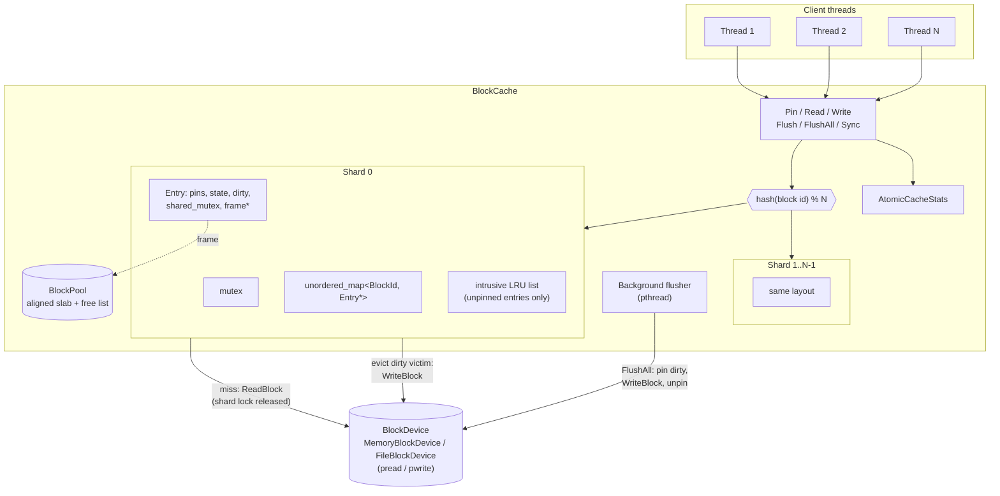

# HotBlock

A thread-safe C++17 block cache with LRU eviction, a write-back policy and
memory-pooled block frames. Put it in front of a block device: it keeps hot
blocks in memory, absorbs repeated writes and writes dirty data back to the
device when blocks are evicted, flushed, or picked up by a background flusher.

Google Test suites check cache coherence, concurrent access and eviction
correctness under load.

## Features

- **Sharded LRU**: block ids are hashed onto N shards. Each shard has its own
  mutex, hash map and intrusive LRU list, so unrelated blocks rarely contend.
- **Memory pool**: all block frames come from one aligned slab
  (`posix_memalign`, 4 KiB by default). Once the cache has warmed up, the hot
  path makes no heap allocations.
- **Pinning**: a `BlockHandle` is an RAII pin. Pinned blocks are never evicted.
  Only unpinned blocks sit on the LRU list, so eviction is an O(1) pop.
- **Reader/writer data locks**: each block has a `std::shared_mutex`, so many
  readers can share a block while a writer gets it exclusively.
- **Single-flight loads**: on a miss the cache publishes a `kLoading`
  placeholder and reads the device *without* holding the shard lock. Other
  threads that want the same block wait for that one read.
- **Write policies**:
  - *write-back* (default): writes mark the frame dirty. The data reaches the
    device on eviction, `Flush`/`FlushAll`/`Sync`, cache destruction, or a
    background flusher pass.
  - *write-through*: dirty data is written when the handle is released (or
    inside `Write()`, which returns I/O errors to the caller).
- **Background flusher**: a named POSIX thread runs on a timer. It also wakes
  early once the dirty fraction reaches a set ratio, so eviction victims are
  usually already clean.
- **Failure safety**: if a write-back fails, the block stays resident and
  dirty, so no data is lost and the write is retried later. A failed load is
  never cached.
- **Stats**: atomic counters for hits, misses, evictions, write-backs, load
  waits, load failures and flusher passes, plus gauges for dirty and resident
  blocks.

## Architecture



### Lifecycle of a request

```
Pin(id)
  lock shard
  ├─ hit, kReady   → unlink from LRU if pins==0, ++pins, return handle
  ├─ hit, kLoading → wait on shard cv, retry lookup
  └─ miss          → take a free entry (frame from BlockPool)
                     or evict LRU tail (write back first if dirty)
                     publish kLoading, unlock, device read, lock, mark kReady, notify
Handle release
  [write-through + dirty → write block]
  lock shard, --pins, if 0 → push to LRU front
```

### Locking rules

| Lock | Guards | Notes |
|------|--------|-------|
| `Shard::mu` | map, LRU list, `pins`, `state` | Released during device reads. Evicting a dirty victim writes it back while the lock is held (the victim has no pins, so nobody else can touch it). |
| `Entry::data_mu` (shared) | block bytes | Readers take it shared, writers exclusive. Flush takes it shared, so it blocks writers but not readers. |
| `BlockPool::mu` | free list | Used only on the first fill of an entry and when entries are released. |
| `flusher_mu_` | flusher sleep/wake | Never held across I/O. |

The shard lock is never held while waiting for a data lock, so the two levels
cannot deadlock. Release a block's data lock before you release its handle.

## Layout

```
include/hotblock/
  types.h            BlockId, Status
  block_device.h     BlockDevice, MemoryBlockDevice, FileBlockDevice
  block_pool.h       aligned slab frame allocator
  lru_list.h         intrusive O(1) LRU list
  cache_options.h    capacity, shards, write policy, flusher tuning
  cache_stats.h      stats snapshot + atomic counters
  posix_thread.h     RAII pthread wrapper
  block_cache.h      BlockCache, BlockHandle
src/                 implementations
tests/               Google Test suites (+ fault-injecting test device)
bench/               hotblock_bench throughput driver
```

## Usage

```cpp
#include "hotblock/block_cache.h"

hotblock::MemoryBlockDevice dev(/*block_size=*/4096, /*num_blocks=*/1 << 16);

hotblock::CacheOptions opts;
opts.capacity_blocks  = 1024;
opts.num_shards       = 16;
opts.write_policy     = hotblock::WritePolicy::kWriteBack;
opts.background_flush = true;

hotblock::BlockCache cache(&dev, opts);

// Byte-range helpers
cache.Write(42, /*offset=*/0, "hello", 5);
char buf[5];
cache.Read(42, 0, buf, sizeof(buf));

// Zero-copy access via a pinned handle
hotblock::BlockHandle h;
if (cache.Pin(42, &h).ok()) {
  auto lock = h.WriteLock();
  h.mutable_data()[0] = 'H';
  h.MarkDirty();
}  // lock released, then handle unpinned

cache.Sync();  // flush all dirty blocks and fsync the device
```

## How to run

Requirements: CMake 3.16 or newer, a C++17 compiler (GCC 9+ or Clang 10+), and
a POSIX system (Linux or macOS). The first configure downloads GoogleTest
v1.14.0 through `FetchContent`, so it needs network access. No credentials or
special hardware are required.

```bash
cmake -S . -B build -DCMAKE_BUILD_TYPE=Release
cmake --build build -j

# Benchmark: in-memory device, 8 threads, 80% reads, Zipf(0.99) skew
./build/hotblock_bench --threads 8 --capacity 4096 --working-set 16384 --seconds 5

# Against a real file with the background flusher
./build/hotblock_bench --file /tmp/hotblock.img --flusher --read-ratio 0.5

# Write-through for comparison
./build/hotblock_bench --policy through
```

`hotblock_bench` prints throughput, hit rate, the full stats line and the
number of device reads and writes. The device numbers show how much I/O
write-back saves compared with write-through.

## How to test

```bash
cmake -S . -B build
cmake --build build -j
ctest --test-dir build --output-on-failure
# or run the binary directly, optionally filtered:
./build/hotblock_tests --gtest_filter='Configs/ConcurrencyTest.*'
```

ThreadSanitizer or AddressSanitizer builds (recommended for the concurrency
suites):

```bash
cmake -S . -B build-tsan -DHOTBLOCK_SANITIZE=thread -DCMAKE_BUILD_TYPE=Debug
cmake --build build-tsan -j && ctest --test-dir build-tsan --output-on-failure
```

| Suite | Covers |
|-------|--------|
| `block_device_test` | memory/file round trips, range checks, persistence across reopen |
| `block_pool_test` | alignment, frame reuse, foreign-pointer rejection, concurrent alloc/free |
| `lru_list_test` | recency order, promote, unlink during iteration |
| `block_cache_test` | hits/misses, partial I/O, handle moves, shard sizing, load failures, single-flight loads |
| `eviction_test` | LRU order, scan eviction, pin protection, dirty victim write-back, failed write-back keeps data |
| `write_back_test` | write coalescing, `Flush`/`FlushAll`/`Sync`, destructor flush, write-through, background flusher timer and dirty-ratio trigger |
| `concurrency_test` | run in three setups (roomy, eviction-pressured, pressured with the flusher racing writers): lost-update-free read-modify-write, no torn reads, disjoint writers surviving eviction storms with device verification, pinned block surviving churn, exactly one device read per miss |
